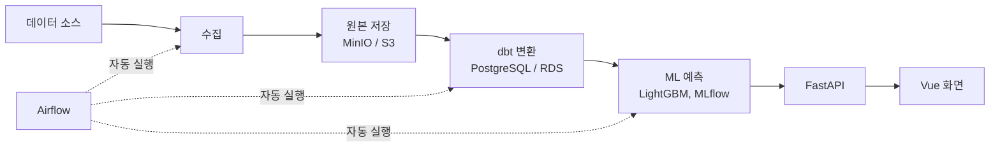

# ⚽ Kickcast

**Kickcast = Kick(축구) + Forecast(예보)**

배트맨(체육진흥투표권 공식 온라인 발매처)에서 경기를 고를 때 판단을 돕는 축구 경기 분석 서비스입니다.
축구 데이터를 수집·정제하고 ML 모델로 승무패 확률을 예측해서, 사용자가 입력한 배트맨 배당과 비교한
기대값, 위험도, 근거를 보여줍니다.

> 현재 상태: 프로젝트 준비 단계입니다. 아직 구현된 코드는 없습니다.
>
> Kickcast는 19세 이상을 위한 분석 정보만 제공합니다. 예측은 결과를 보장하지 않습니다.

## 핵심 기능

- **승무패 확률 예측**: 배트맨 발매 대상 축구 경기의 승·무·패 확률을 예측합니다.
- **기대값 계산**: 사용자가 입력한 배당과 모델 확률을 비교해 기대값을 계산합니다.
- **조합 시뮬레이션**: 여러 경기를 조합했을 때의 확률과 위험도를 시뮬레이션합니다.
- **AI 분석 리포트**: 모델이 계산한 수치와 근거만 설명합니다. 확률을 지어내지 않습니다.
- **성능 투명 공개**: 모델의 과거 예측 기록과 성능(Brier Score 등)을 공개합니다.

## 서비스 원칙

- 배트맨 발매 경기 분석만 제공합니다. 구매 대행, 대리 구매, 구매 접수, 구매 건당 수수료는 없습니다.
- 사설 토토나 해외 베팅 사이트로 연결하거나 홍보하지 않습니다.
- 19세 이상만 이용할 수 있습니다.
- 기대값이 마이너스이거나 데이터가 부족한 경기는 그 사실을 분명히 표시합니다.
- 배트맨 배당은 약관 확인 전까지 자동 수집하지 않고, 사용자가 직접 입력합니다.
- 공개 배포, 유료화, 광고 도입 전에 법률 검토와 데이터 이용 약관 확인을 거칩니다.

## 데이터 소스와 출처

첫 리그는 프리미어리그입니다. 공개 배포 전에 각 소스의 이용 약관과 출처 표기 조건을 확인합니다.

| 소스 | 용도 | 시점 |
| --- | --- | --- |
| football-data.co.uk | 과거 시즌 결과·기본 기록·배당 (학습, 기준 모델, 백테스트) | 핵심 |
| football-data.org | 다가오는 경기 일정과 최신 결과 | 핵심 |
| ClubElo | 경기 전날 기준 팀 Elo 레이팅 | 핵심 |
| [openfootball](https://github.com/openfootball) (CC0) | 스코어 교차 검증 | 핵심 |
| [Transfermarkt 데이터셋](https://github.com/dcaribou/transfermarkt-datasets) | 스쿼드·선발 라인업 시장가치 | 확장 |
| Understat | 빅5 리그 xG (약관 확인 후 수집) | 확장 |
| K리그 기록 | 수집 방식과 약관 확인 후 결정 | 배포 전 |
| 배트맨 배당 | 사용자가 화면에서 직접 입력 | 사용자 입력 |

## 아키텍처 계획: 로컬 → AWS

로컬(Docker Compose)에서 먼저 완성한 뒤 AWS로 이전해 공개 배포합니다.
코드는 그대로 두고 환경 변수만 바꿔서 전환할 수 있게 설계합니다.

| 영역 | 로컬 | AWS |
| --- | --- | --- |
| 원본 저장 | MinIO | S3 |
| DB | PostgreSQL | RDS for PostgreSQL |
| 실행 환경 | Docker Compose | EC2 |
| 비밀 정보 | `.env` | SSM Parameter Store 또는 Secrets Manager |
| 로그·알림 | 로컬 로그 | CloudWatch |
| 권한 | 로컬 계정 | IAM 역할 (최소 권한) |
| 공개 배포 | 해당 없음 | 도메인, HTTPS |

AWS 이전은 Airflow 자동화가 로컬에서 안정적으로 동작한 이후에 진행합니다.

## 기술 스택

Python 3.12, PostgreSQL, MinIO/S3, dbt, Airflow, Docker Compose, scikit-learn, LightGBM, MLflow, FastAPI, Vue

선택: Kafka, Spark Streaming
